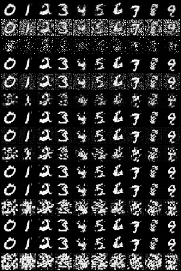

# Flow Matching vs DDPM: Image Generation from Scratch (DiT Backbone)

[](https://www.python.org/)
[](https://pytorch.org/)
[](https://github.com/astral-sh/uv)
[](LICENSE)

*A clean, first-principles PyTorch implementation and comparative benchmark of Continuous-Time Optimal Transport Flow Matching against Denoising Diffusion Probabilistic Models (DDPM) using a shared Patch Diffusion Transformer (DiT) backbone.*

---

## 🌟 Core Capabilities & Key Highlights

* **Shared Diffusion Transformer (DiT) Backbone:** Patch embedding with 2D sinusoidal position encodings and AdaLN-Zero identity initialization (1,259,024 parameters).
* **Continuous Optimal Transport Flow Matching:** Regresses straight constant-velocity probability paths ($u = x_1 - x_0$) for rapid ODE integration.
* **Discrete DDPM & Deterministic DDIM:** Discrete linear beta schedule with schedule buffers, continuous reparameterization loss, and uniform schedule-respaced DDIM sampling.
* **1st & 2nd Order Numerical ODE Solvers:** Euler and Heun ODE integration for continuous flow trajectory solving.
* **Batched Classifier-Free Guidance (CFG):** Evaluates conditional and unconditional null-class predictions simultaneously in a single forward pass.
* **Rigorous Benchmark Suite:** Controlled side-by-side NFE comparison across matching initial noise latents and function evaluations [5, 10, 20, 50, 100].

---

## 🔬 Core Findings: Flow Matching vs DDPM



*Figure 1: Side-by-side comparison across 10 classes and matching NFE budgets [5, 10, 20, 50, 100]. Rows compare Flow Matching (Euler, Heun) against DDPM (DDIM) starting from identical initial noise latents.*

| Dimension | Flow Matching (OT-Flow) | DDPM / DDIM | Why? |
|---|---|---|---|
| **Trajectory Geometry** | Straight-line paths connecting noise to data | Curved Brownian diffusion path | Flow matching targets constant velocity $u = x_1 - x_0$. |
| **Low-NFE Quality (10–20 NFE)** | **Sharp, coherent digits** | Noisy, fragmented artifacts | Straight paths can be integrated with large step sizes ($\Delta t = 0.05$) without accumulating truncation drift. |
| **Numerical Solvers** | Euler (1st order) & Heun (2nd order) ODEs | Respaced DDIM (deterministic ODE) | Solves $\frac{dx}{dt} = v_\theta(x, t)$ directly. |
| **Training Speed** | Fast, stable convergence | Requires more epochs for sharp boundaries | Velocity regression provides strong, direct directional gradients. |

---

## 📐 Architecture: Diffusion Transformer (DiT)

Both paradigms share the identical neural network engine to ensure an apples-to-apples comparison:

```
Input Image (B, C, H, W)
       │
       ▼
[ Patch Embedding: Conv2d(stride=p) ]  ──► Tokens: (B, N, D) + 2D Sin/Cos Pos Embed
       │
       ▼
┌────────────────────────────────────────────────────────┐
│ AdaLN-Zero Transformer Block (Repeated D times)        │
│                                                        │
│ Conditioning: c = Embed_time(t) + Embed_class(y)       │
│ Modulation: (γ1, β1, α1, γ2, β2, α2) = Linear(c)       │
│                                                        │
│ x = x + α1 ⊙ MultiHeadAttention( LayerNorm(x)·(1+γ1) + β1 )
│ x = x + α2 ⊙ MLP( LayerNorm(x)·(1+γ2) + β2 )           │
└────────────────────────────────────────────────────────┘
       │
       ▼
[ Final AdaLN Modulation + Linear Projection ]
       │
       ▼
Unpatchify ──► Output Tensor: (B, C, H, W)  [Velocity or Noise]
```

---

## 📚 Mathematical Formulations

Notation:
* $x_{\text{data}} \in \mathbb{R}^{C \times H \times W}$: Clean data sample.
* $x_{\text{noise}} \sim \mathcal{N}(0, \mathbf{I})$: Standard Gaussian noise.
* $t$: Continuous ($t \in [0, 1]$) or discrete ($t \in [1, 1000]$) time variable.
* $y \in \{0, \dots, K\}$: Class label (where $K$ is the null token for CFG).

### 1. Flow Matching (Continuous Optimal Transport Flow)
* **Straight Probability Path:**
  $$x_t = (1 - t) \cdot x_{\text{noise}} + t \cdot x_{\text{data}}, \quad t \in [0, 1]$$
* **Target Velocity Field:**
  $$u_t(x_t \mid x_{\text{noise}}, x_{\text{data}}) = \frac{d}{dt} x_t = x_{\text{data}} - x_{\text{noise}}$$
* **Velocity Matching Loss:**
  $$\mathcal{L}_{\text{FM}}(\theta) = \mathbb{E}_{x_{\text{data}}, x_{\text{noise}}, t, y} \left[ \| v_\theta(x_t, t, y) - (x_{\text{data}} - x_{\text{noise}}) \|^2 \right]$$
* **Numerical Solvers:**
  * **1st Order Euler:** $x_{t + \Delta t} = x_t + \Delta t \cdot v_\theta(x_t, t, y)$
  * **2nd Order Heun:**
    $$\tilde{x}_{t + \Delta t} = x_t + \Delta t \cdot v_\theta(x_t, t, y)$$
    $$x_{t + \Delta t} = x_t + \frac{\Delta t}{2} \left[ v_\theta(x_t, t, y) + v_\theta(\tilde{x}_{t + \Delta t}, t + \Delta t, y) \right]$$

### 2. DDPM & DDIM (Discrete Diffusion Process)
* **Forward Schedule:**
  $$x_t = \sqrt{\bar{\alpha}_t} \cdot x_{\text{data}} + \sqrt{1 - \bar{\alpha}_t} \cdot \epsilon, \quad \epsilon \sim \mathcal{N}(0, \mathbf{I})$$
* **Noise Prediction Loss:**
  $$\mathcal{L}_{\text{DDPM}}(\theta) = \mathbb{E}_{x_{\text{data}}, \epsilon, t, y} \left[ \| \epsilon - \epsilon_\theta(x_t, t, y) \|^2 \right]$$
* **DDIM (Deterministic ODE Counterpart with Timestep Respacing):**
  $$x_{t-1} = \sqrt{\bar{\alpha}_{t-1}} \left( \frac{x_t - \sqrt{1 - \bar{\alpha}_t} \epsilon_\theta}{\sqrt{\bar{\alpha}_t}} \right) + \sqrt{1 - \bar{\alpha}_{t-1}} \cdot \epsilon_\theta$$

### 3. Classifier-Free Guidance (CFG)
During inference, conditional and unconditional predictions are linearly combined with guidance weight $w \ge 1.0$:
$$\hat{\phi}_{\text{guided}}(x_t, t, y) = \phi_\theta(x_t, t, \emptyset) + w \cdot \left( \phi_\theta(x_t, t, y) - \phi_\theta(x_t, t, \emptyset) \right)$$

---

## 📁 Repository Structure

```text
flow_matching_ddpm/
├── README.md                      # Mathematical specification & empirical findings
├── pyproject.toml                 # uv package configuration & dependencies
├── configs/
│   └── mnist_dit.yaml             # Reproducible MNIST benchmark configuration
├── data/                          # Cached datasets (git-ignored)
├── checkpoints/                   # Saved model weights (git-ignored)
├── outputs/                       # Generated grids & evaluation plots (git-ignored)
├── src/flow_matching_ddpm/
│   ├── __init__.py                # Package exports
│   ├── model.py                   # DiT backbone, PatchEmbed, AdaLNZeroBlock
│   ├── loss.py                    # DDPMLoss and FlowMatchingLoss
│   ├── sampler.py                 # Euler, Heun, and respaced DDIM samplers
│   ├── dataset.py                 # Configurable dataset loader
│   ├── train.py                   # Unified training pipeline with EMA & CFG
│   ├── benchmark.py               # Side-by-side NFE comparison grid generator
│   └── utils.py                   # EMA tracker, cosine scheduler, grid saver
└── tests/
    ├── __init__.py
    ├── test_shapes.py             # Shape preservation & identity init tests
    ├── test_loss.py               # Schedule bounds & loss gradient tests
    ├── test_sampler.py            # ODE solver numerical bounds & reproducibility
    └── test_overfit.py            # 1-batch overfit convergence test (>99% drop)
```

---

## 🚀 Quickstart & Reproducibility

### 1. Installation
```bash
git clone https://github.com/HamzA-1729/flow_matching_ddpm.git
cd flow_matching_ddpm
uv sync
```

### 2. Run Complete Test Suite
```bash
uv run pytest -v
```

### 3. Training
```bash
# Train Flow Matching on MNIST (5 epochs)
uv run python -m flow_matching_ddpm.train --mode flow --config configs/mnist_dit.yaml --epochs 5

# Train DDPM on MNIST (5 epochs)
uv run python -m flow_matching_ddpm.train --mode ddpm --config configs/mnist_dit.yaml --epochs 5
```

### 4. Generate Side-by-Side NFE Benchmark Grid
```bash
uv run python -m flow_matching_ddpm.benchmark --config configs/mnist_dit.yaml
```

---

## 📖 References
1. **Flow Matching for Generative Modeling** — Lipman et al., 2022 ([arXiv:2210.02747](https://arxiv.org/abs/2210.02747))
2. **Denoising Diffusion Probabilistic Models (DDPM)** — Ho et al., 2020 ([arXiv:2006.11239](https://arxiv.org/abs/2006.11239))
3. **Denoising Diffusion Implicit Models (DDIM)** — Song et al., 2020 ([arXiv:2010.02502](https://arxiv.org/abs/2010.02502))
4. **Scalable Diffusion Models with Transformers (DiT)** — Peebles & Xie, 2022 ([arXiv:2212.09748](https://arxiv.org/abs/2212.09748))

---

## 📜 License
Distributed under the [MIT License](LICENSE).
